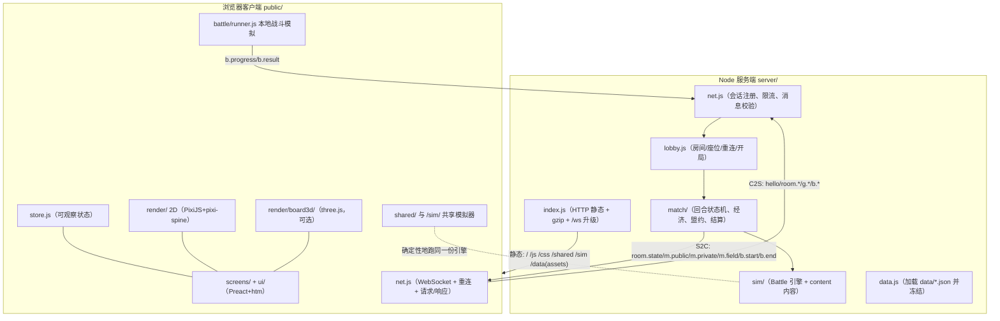

# 卫戍协议：盟约 · 二次开发指南（中文）

> 对应版本 **0.4.0**（`package.json` / `shared/constants.js APP_VERSION`）；接手入口见 [`docs/HANDOVER.md`](HANDOVER.md)。
> 本文基于本仓库快照整理，`文件:行号` 为整理时的位置，重构后可能漂移，**一切以代码为准**。
> 代码/注释/标识符用英文，面向玩家的文案用简体中文——沿用项目既有约定。

---

## 目录

> 导航用；每节正文才是准的（按标题里的编号 grep 更快）。

- 0. 文档导航（先读哪一份？）
- 1. 一分钟总览
- 2. 运行时架构（一张图）
- 3. 目录与模块地图
- 4. 核心机制详解
- 5. 二次开发手册（Recipes）
- 6. 优化建议（二次开发优先看这里）
- 7. 测试与调试速查
- 8. 约定与坑
- 9. 关键文件速查
- 10. 上游 v0.2.6 合并带入的特性

## 0. 文档导航（先读哪一份？）

仓库已有非常完整的英文设计文档，本文不重复它们，而是给出**中文的全局地图 + 二次开发落点 + 优化清单**。

| 文档 | 语言 | 作用 |
|---|---|---|
| `docs/HANDOVER.md` | 中英 | **接手入口**：仓库地图、本地运行、构建 / 测试、内容制作、上游合并、发布与部署、已知坑 |
| `README.md` | 中 | 项目介绍、玩法、运行方式 |
| `docs/DESIGN.md` | 英 | **唯一权威（索引）**：§号全局不变；当前规则在 `docs/design/*.md`、各次玩测/发布的修订在 `docs/history/*.md`（改动规则前必读对应的 `design/` 篇） |
| `docs/META.md` | 英 | 对局/经济引擎：回合流程、商店、盟约、联防、最终攻势实现细节 |
| `docs/SIM.md` | 英 | 战斗模拟引擎参考：钩子、技能描述格式、职业默认行为 |
| `docs/DATA.md` | 英 | `data/*.json` 的生成规则与 schema |
| `docs/ASSETS.md` | 英 | 素材来源、目录结构、清单（`data/assets.json`） |
| `docs/BALANCE.md` | 英 | 难度模型与测量方法 |
| `docs/PLAYING.md` | 中 | 玩法指南（给玩家） |
| `docs/MATCHMAKING.md` | 中 | **野排（搜寻队友）**：账号 / SQLite / 匹配池 / 协议 / 客户端改动记录（本次新增功能） |
| `docs/DEPLOY.md` | 英 | 部署：防火墙、开机自启、反向代理、Docker |
| `docs/research/` | 中/英 | 官方规则、数据、界面的调研原始记录（`00-INDEX.md` 起步） |
| `shared/protocol.js` | — | **线协议即规范**（`C2S` / `S2C` 表 + 校验器） |
| **`docs/DEV-GUIDE-ZH.md`（本文）** | 中 | 结构地图 + 二次开发手册 + 优化建议 |

> 冲突优先级：`DESIGN.md` > `docs/research/` > “选最忠实且最简单的实现并写进模块头注释”。
> 注意：`DESIGN.md` §2 提到的 `shared/rules.js` **在当前代码中并不存在**（属文档滞后），实际共享面是 `protocol.js` / `constants.js` / `bandBonds.js` / `loadoutRecord.js`。

---

## 1. 一分钟总览

- **是什么**：《明日方舟》季节玩法「卫戍协议：盟约」的非官方同人网页复刻，浏览器即开即玩，单人 / 1–4 人联机合作（空位可加 AI）。
- **技术栈**：Node.js ≥ 22（ESM，唯一运行时依赖 `ws`）＋ 原生 ES Module 前端（无打包器、无 TypeScript）。前端库全部 vendored 到 `public/vendor/`：PixiJS 7.4.2 + pixi-spine 4.0.6（2D 战场）、three.js（可选 3D 棋盘）、Preact 10 + htm（UI）。共享代码放 `shared/`，服务端与浏览器都 import。
- **核心架构**：**服务端权威 + 客户端战斗模拟**。服务器只管大厅、经济、回合与规则校验；每名玩家的战斗在**自己的浏览器里用同一份确定性模拟器**（`server/sim/` 通过 `/sim/` 静态路径给浏览器）跑，服务器只收 `b.progress` / `b.result` 并（可选）复算。
- **运行**：
  ```bash
  npm install        # postinstall 会执行 tools/vendor.mjs（拷库到 public/vendor）
  npm run setup      # 检查环境 + 下载约 250MB 素材（可中断、续传）
  npm start          # http://localhost:3000
  ```
  也可用启动脚本 `scripts/start-windows.bat` / `scripts/start.sh` / `npm run launch`。
- **一条命令改数据**：不要手改 `data/*.json`，改 `tools/build-data.mjs` 后 `node tools/build-data.mjs`（例外：`data/tuning.json`、`data/assets.json`）。

---

## 2. 运行时架构（一张图）



**要点**

1. **服务器从不逐帧模拟玩家战斗**（`SP_COMBAT=client` 默认）：它只发 `b.start` 规格与 `b.pool`（Boss 共享血条），收进度/结果。设 `SP_COMBAT=server` 可由服务器模拟并推流（`match/fields.js` 的 `FieldRunner`）。
2. **复算校验**：`SP_VERIFY=off|sample|all` 控制服务器是否用同一 sim 复算客户端结果（`fields.js validateClientResult`）。
3. **静态层已高度优化**：gzip LRU + in-flight 去重、ETag/304/Range、WS 背压感知发送、重消息二级令牌桶。
4. **无数据库**：房间与对局都在内存，重启即清空；断线重连靠内存里的 token（同盟 10 分钟、独立 24 小时）。

---

## 3. 目录与模块地图

### 3.1 `shared/`（前后端共享，纯 ESM，无 Node API）

| 文件 | 职责 |
|---|---|
| `constants.js` | 协议版本、`APP_VERSION`、`MAX_SEATS`、难度、`PHASE` 阶段枚举、`GEO` 坐标、`BOND_LAYER_CAP`、`BOSS_HIT_LIMIT`、错误码 `ERR`/`ERR_TEXT`、表情目录 |
| `protocol.js` | **线协议规范**：`C2S` 消息表 + 字段校验器、`S2C` 列表、`validateC2S`、`checkLoadout`/`resolveLoadout`、`isBattleResult` |
| `bandBonds.js` | 从策略文本/数据推导其盟约（build-data 与 `match/gamedata.js` 共用） |
| `loadoutRecord.js` | 干员调配（携带技能/模组）解析：`resolveRecordLoadout`、`composeStats`、`attackRangeGrid` 等，sim 与 UI 共用一份实现 |

### 3.2 `server/`（平台层）

| 文件 | 职责 | 关键位置 |
|---|---|---|
| `index.js` | 进程启动、HTTP 静态服务（gzip、ETag、Range）、`/healthz`、`/ws` 升级准入 | `createStaticHandler()`、`startServer()` |
| `net.js` | 会话注册表、WS 收发与背压、令牌桶限流、帧管线、`hello`/重连、心跳与过期清理 | `Network.onFrame`、`SessionRegistry`、`sanitizeName` |
| `lobby.js` | 房间（4 字母码）、座位、房主、AI 座位、准备/开局、重连 token、房间→对局接线、断线宽限 | `Room`、`Lobby`、`startMatch`、`routeGame` |
| `data.js` | 加载并**深冻结** `data/*.json`，建索引（`getChess`/`getBond`…） | `loadData`、`getData` |

### 3.3 `server/match/`（对局与经济引擎）

| 文件 | 职责 |
|---|---|
| `Match.js`（~3000 行） | 对局状态机、计时、回合循环、合作编排、视图广播（公开/私有/战场） |
| `PlayerState.js`（~1650 行） | 每玩家权威状态（经济/商店/手牌/棋盘/装备/盟约/LP）与全部 prep 指令处理器 |
| `pool.js` | 每位干员的共享复制池、禁用盟约、概率与刷新 |
| `board.js` | 部署合法性、部署上限、手牌/临时区、合成检测 |
| `bondsMeta.js` | 盟约成员计数（棋盘/手牌/精锐）、激活层级、持久层数 |
| `effectsMeta.js` | prep 阶段效果注册表与派发器（特质/策略/装备/盟约） |
| `choices.js` | 机变选卡：按家族生成、选卡顺序、超时、应用 |
| `waves.js` | 本局敌方阵营、每回合刷怪表、数值缩放、悬赏 |
| `unite.js` | 联防：帮打者选择、漏怪聚合、LP 归因 |
| `finalAssault.js` | R14/R15 配对、合并 LP、共享 Boss 血池、超时扣血 |
| `results.js` | 结算统计与称号（评语） |
| `bot.js`（~1800 行） | AI 队友 / 掉线托管：选策略、经济与摆阵规划 |
| `gamedata.js` | `data/*.json` 的类型化只读视图（默认值、计时、模式） |
| `fields.js` | 战场运行：`FieldRunner`（服务端推流）、`HeadlessJob`、客户端结果校验 |
| `scheduler.js` | `RealScheduler` / `VirtualScheduler` 计时抽象（测试用虚拟时间） |
| `invariants.js` / `audit.js` | 不抛异常的结构不变量检查 / 规则级行为断言（测试用） |
| `StubMatch.js` | 平台层桩实现（仅测试） |

### 3.4 `server/sim/`（确定性战斗引擎，前后端共用）

| 文件 | 职责 |
|---|---|
| `Battle.js`（~2400 行） | 战斗主体：构造、`step()`、`on/off` 钩子总线、全部公共 API（伤害/治疗/状态/召唤/推拉/层数…） |
| `constants.js` | Tick、速度、力度-重量表、元素/爆发表、上限 |
| `rng.js` | 种子化 mulberry32 PRNG（唯一随机源） |
| `grid.js` | 网格、瓦片查询、可通行性、官方 SPFA 流场寻路（按目标+版本缓存） |
| `units.js` | `Unit`（op/token/enemy/device）与惰性 buff 聚合 `_recalc()` |
| `buffs.js` | Buff 模型、修正键、状态目录 `STATUS` |
| `damage.js` | 伤害/治疗管线、减伤、护盾、闪避、元素槽与爆发、流失 |
| `targeting.js` | 范围键旋转、目标合法性、优先级排序 |
| `body.js` | 巨型单位命中矩形判定（所有范围判定的统一入口） |
| `projectiles.js` | 弹道飞行/命中 |
| `skills.js` | 技能运行时：SP/充能/触发器/持续/弹药 |
| `ai.js` | 我方攻击循环、敌人寻路与攻击、`remainingDistance` |
| `fear.js` | 恐惧移动（可达地块扇面、随机检查点） |
| `snapshot.js` | 客户端序列化（紧凑元组） |
| `dir.js` | 四方向、旋转/镜像工具 |
| `spec.js` | `BattleSpec` 构建/消费、`LocalBossPool`、结果摘要 |
| `simdata.js` | 数据访问与记录归一化（`DataSource`、loadout 解析） |
| `professions.js` | 职业/子职业攻击档案（`resolveProfile`） |
| `content/` | **全部游戏内容**（见 §4.5） |

### 3.5 `server/sim/content/`（内容，双侧模式）

```
content/
  index.js         安装全部内容 / registerAllMeta
  kits/ops/*.js     按 baseChessId 手写的干员 kit（技能+天赋），一干员一文件（注册表 kits/index.js；公共 helper 在 kits/shared/tierN.js）
  tokens.js        召唤物/炎佑/地图角色
  bonds/{core,addon}.js        盟约（战斗侧 + meta 侧）
  items/{battle,meta}.js       装备与法术
  bands/{battle,meta}.js       策略
  garrisons/{battle,meta}.js   特质（兵力）
  enemies.js       敌人能力规格 + 通用特殊类型
  bosses.js        Boss 脚本（boss_1…boss_10）
  devices.js       关卡装置与特殊地形
  choices.js       机变卡战斗侧
  generic.js       无手写 kit 时的通用回退
  support/{index,meta}.js      成员关系、层数、contentInfo 交接
```

### 3.6 `public/`（浏览器客户端，原生 ESM）

| 目录/文件 | 职责 |
|---|---|
| `index.html` | 单页；import map（preact/htm）；ES5 兜底诊断；按屏引入 CSS |
| `js/main.js` | 启动、路由、`wireNet()`、全局叠加层、错误边界 |
| `js/store.js` | 极简可观察 store（`useStore` 选择器 + Preact 绑定）、`serverNow()`、偏好存取 |
| `js/net.js` | WebSocket 客户端、指数退避重连、心跳/时钟同步、请求/响应、身份与多标签处理 |
| `js/data.js` | 拉取 `/data/*.json`，建立与 `server/data.js` 相同的索引 |
| `js/assets.js` | 素材 URL 助手 + 图片缓存 + **引用计数 LRU Spine 加载器**（带内存预算） |
| `js/audio.js` | Web Audio：BGM/SFX、声道增益、语音限制器、`b.ev`→音效映射 |
| `js/screens/` | `title` / `lobby` / `room` / `briefing` / `bandDraft` / `game` / `result` / `loadout` |
| `js/ui/` | `hud`、`shopBar`、`detailPanel`、`choiceOverlay`、`facingWheel`、`components`、**`gameLogic`** 等（纯逻辑 + 组件） |
| `js/render/` | `app`（战场控制器）、`projection`、`tiles`、`units`、`spine`、**`fx`（最大）**、`interp`、`drag`、`pick`、`textures`、`impostor`、`pen`、`prepfield`、`style`、`boardArt` |
| `js/render/board3d/` | three.js 3D 棋盘：`load` / `scene` / `layout` / `materials` / `atlas` / `obj` |
| `js/battle/` | `runner.js`（浏览器内跑共享 sim）、`observe.js`（观战规则） |
| `css/` | `theme` / `components` / `screens/*` / `emotes` / `devices` |
| `dev/` | 本地开发：`uikit.html`、`game-mock`、`render-demo`、`recordings/*.json` |

### 3.7 `data/`（生成数据，见 §4.7）

`chess.json`(1.66MB)、`enemies.json`(0.40MB)、`stages.json`(0.26MB)、`effects.json`(0.25MB)、`items.json`(0.17MB)、`garrisons.json`(0.15MB)、`waves.json`(0.14MB)、`tokens.json`(0.13MB)、`choices.json`(0.12MB)、`bonds.json`(0.08MB)、`config.json`(0.06MB)、`bands.json`(0.04MB)、`factions.json`、`bosses.json`、`emotes.json`、`assets.json`、`tuning.json`。

### 3.8 `tools/` `scripts/` `test/`

- **`tools/build-data.mjs`（~3250 行）**：唯一生成 `data/*.json`（除 `emotes.json`/`assets.json`）的脚本。
- `tools/build-emotes.mjs`、`tools/fetch-assets.mjs` + `tools/assets/**`（下载/瘦身/索引素材）、`tools/vendor.mjs`。
- `tools/setup.mjs` / `doctor.mjs`、`scripts/launch.mjs` + 各平台启动脚本、`scripts/install-service-windows.ps1`（Windows 计划任务 + 防火墙）。
- 平衡/基准/调试：`balance.mjs`、`botbench.mjs`、`matchrun.mjs`、`simrun.mjs`、`kit-coverage.mjs`、`record-battle.mjs`、`crop-board-atlas.mjs`。
- **`test/`**：`node:test`，根目录 11 个套件 + `content/`(31) + `match/`(65) + `sim/`(49) + `render/`(47) + `ui/`(58) + `e2e/`(3)；浏览器/E2E 用例由环境变量 `SP_E2E` / `SP_REAL_E2E` / `RENDER_E2E` 控制，CI 里关闭。

---

## 4. 核心机制详解

### 4.1 两种战斗模拟模式

| 模式 | 环境变量 | 行为 |
|---|---|---|
| 客户端模拟（默认） | `SP_COMBAT=client` | 服务器发 `b.start`（`BattleSpec` + 种子）+ `b.pool`；客户端 `battle/runner.js` 用 `/sim/` 跑，回 `b.progress`(~1Hz，Boss 4Hz) 与 `b.result` |
| 服务器模拟 | `SP_COMBAT=server` | 服务器用 `match/fields.js FieldRunner` 逐帧跑并推 `b.snap`/`b.ev` |

校验：`SP_VERIFY=off|sample|all` → `fields.js validateClientResult` 复算客户端上报（含 `specBounds` 边界检查，防作弊/防漂移）。

### 4.2 网络协议与消息校验

- **声明**：客户端→服务器消息是 `shared/protocol.js` 的 `C2S` 键；值 `{ 字段: 校验器, …, $optional: [...] }`。服务器→客户端消息列在 `S2C`（仅用于文档 + 测试校验）。
- **两道校验**：`net.js` 做廉价结构门（对象、`t` 是字符串且 `Object.hasOwn(C2S, t)`），再交给 `validateC2S` 做逐字段校验。
- **请求/响应**：处理器返回 `{ok:true}` 或 `{error, detail?}`；`rid` 回显给客户端做 Promise 关联；错误码走 `shared/constants.js ERR/ERR_TEXT`，未知码归 `INTERNAL`。
- **重消息**：`g.watch` / `room.loadout` 走二级令牌桶，防止观战/调配刷爆。
- **加一条消息**（6 步）：
  1. `shared/protocol.js` 的 `C2S` 加键 + 字段校验器（可选字段放 `$optional`）；
  2. 服务端 `Match._handle`（`g.*`）/ `Lobby.onMessage`（`room.*`）加分支，返回 `{ok}`/`{error}`；
  3. 新发的 S2C 帧登记到 `S2C`；
  4. 客户端 `ui/gameActions.js` 的 `actions.*` 加发送（自校验），`net.on(t, …)` 接收；
  5. 补协议测试（参考 `test/match/*`、`test/ui/*`）；
  6. 更新 `docs/DESIGN.md`/`docs/META.md`（`test/docs-consistency.test.js` 会核对）。

### 4.3 对局状态机（`Match.phase`，`shared/constants.js PHASE`）

```
LOBBY → INFO_CHECK → BAND_DRAFT → BATTLE_CHECK
      → [r=1..N] ROUND_START → [SP_DRAFT?] → PREP → COMBAT → [UNITE?] → SETTLE
      → FINAL_ASSAULT → [HIDDEN_CORE?] → RESULT
```

- 计时统一用可注入的 `scheduler.js`（测试用虚拟时间）；`setDeadline` 发布 `deadline`(ms) + `serverNow` 给客户端做时钟校正。
- 单人/单人人类在非战斗阶段**不计时**（`soloUntimed`）；独立模拟可暂停（`setPause` 会平移所有时钟）。
- 战斗强制 **2× 实速**（60 tick/实秒）；`TICK = 1/30` 游戏秒。

### 4.4 战斗模拟引擎（`sim/Battle.js`）

- **构造**：`new Battle({ seed, kind, modeId, round, stage, rect, timeLimit, players, spawns, routes, sharedBoss, flags })` → `b.step()` 每次推进一个 `TICK`；`b.result()` / `b.snapshot()` / `b.drainEvents()`。
- **钩子总线**（内容唯一接入方式）：`battle.on(name, fn, {priority, owner})`。事件目录见 `DESIGN.md §5.4`（`battleStart/deploy/tick/beforeAttack/attack/hit/damaged/heal/fatal/kill/death/skillStart/skillEnd/ammoUsed/spGain/statusApplied/blocked/enemySpawn/enemyLeak/battleEnd` …）。
- **引擎助手**（内容必须用这些，不许碰内部）：`dealDamage/heal/applyStatus/addBuff/spawnToken/spawnEnemy/addProjectile/push/pull/enemiesInRadius/foesInRadius/alliesFor/unitsInGrid/addLayers/loseHp/addCoins/fx/…`。
- **确定性**：唯一随机源是 `rng.js`；快照/事件按元组编码，客户端与服务端跑出同一结果。

### 4.5 内容系统的"双侧模式"（关键设计）

每个内容域导出**两个入口**：

| 侧 | 入口 | 时机 | 归属 |
|---|---|---|---|
| **战斗侧** | `install(battle)` | 每场 Battle 构造时 | 注册引擎钩子、buff、计时 |
| **准备侧 meta** | `registerMeta(registry)` | 服务器启动时 | 注册 prep 阶段钩子（经济/商店/盟约层数…） |

注册键：`garrison:<key>` / `band:<id>` / `bond:<id>` / `item:<key>` / `choice:<effectId>` / `effect:<id>` / `global:<name>`（`effectsMeta.js`）。两侧通过 `PlayerBattleInput.contentInfo` 交接（`support/meta.js` 写、`support/index.js` 读）。

**通用回退**：没有手写 kit 的干员由 `generic.js` 依据技能黑板的键（atk/attack_speed/def/max_hp/base_attack_time/atk_scale/max_target/duration/ammo…）自动生成技能规格——所以**任何干员都能跑**，只是不如手写的还原。

### 4.6 客户端渲染管线

- **帧循环**（`render/app.js` ticker）：`stepCamera` → 2D 瓦片（`tiles.js` 自定义透视 shader 的 `Mesh`）或 3D 棋盘（`board3d/scene.js` 先画到独立 canvas）→ 单位 `units.js`（Spine 与占位菱形交叉淡入）→ FX（`fx.js` 池化粒子/弹道/伤害数字）→ 人群 impostor 图集 flush → Pixi 叠加层渲染。
- **2D/3D 选择**：`?board=2d|3d` → 需要 WebGL2 且本地素材清单列出 `TX_autochessi_D`；失败自动回退 2D（`boardArtListed`、`disable3d`），并带上下文丢失重试。
- **数据流**：非战斗走 `store.js`；战斗帧**绕过 store**，由 `b.snap`/`b.ev`（或本地 runner）直接进视图；HUD 以 200ms 节流读取。
- **内存管理**：Spine 用引用计数 LRU（`assets.js RefLru`，48MB 空闲预算 + 宽限期）——这是全项目最精细的一块。

### 4.7 数据与素材流水线

- **数据**：`tools/build-data.mjs` 从官方 zh_CN 客户端表（`.cache/gamedata/`）＋ `docs/research/*.json` 生成 14 个 `data/*.json`，确定性（无时间戳）。构建时做大量校验（数量、跨文件引用、19×21、触发偏差…），报告写 `.cache/build-data-report.json`。
- **素材**：`tools/fetch-assets.mjs` + `tools/assets/**` 从社区 dump 下载/处理像素与音频，产出 `public/assets/**`、`public/fonts/**` 与**清单 `data/assets.json`**。有**缩水保护**：新清单若会丢条目则拒绝写入并要求 `--allow-shrink`/`--prune`。
- **规则**：除 `data/tuning.json`（手维护覆盖层）与 `data/assets.json`（由 fetch-assets 生成）外，**不要手改 `data/`**。
- **重新生成**：
  ```bash
  node tools/build-data.mjs          # 或 --offline / --refresh
  node tools/build-emotes.mjs        # 生成 emotes.json
  npm run assets                     # vendor + fetch-assets
  node tools/kit-coverage.mjs --missing   # 哪些可选技能还没手写 kit
  ```

### 4.8 客户端素材交付：本机缓存 + CDN 镜像 + 服务端兜底限速

服务器上行很小（约 2.3 MB/s），而冷启动要拉 ~104 MB 美术，所以交付分四层（**权威细节见 [`docs/ASSETS.md`](ASSETS.md)「Local asset cache & CDN mirror download chain」**；fork 独有：`docs/OUR-FEATURES.md` §10，决策：`docs/MATCHMAKING.md` §42）：

1. **本机缓存**：`public/sw.js`（Service Worker）+ `public/js/assetCache.js`。SW 把 `/assets|/fonts|/vendor` 存进 Cache Storage（`sp-assets`），cache-first；老玩家再来**零下载**（实测：停掉服务器仍能从本机缓存取到）。
2. **CDN 镜像优先**：`GET /asset-index.json`（`server/assetindex.js`）给出 `revision`（`{url:size}` 的内容哈希）+ 每文件大小 + `sources`（**直接读 `public/asset-mirrors.json`** —— 唯一写下来源的地方，后台「来源配置」可直接改、保存即生效）。`js/assetCache.js fetchArtFile` **每个来源 15 秒超时**、按 `files[url]` **校验字节数**，**最后才回退游戏服务器**；`revision` 一致则整批跳过。`SP_ASSET_RELAY` 覆盖全路由来源、`SP_ASSET_REF=''` 关闭来源层。
3. **服务端兜底限速**：`server/http/files.js` 的进程级令牌桶只限速 `public/assets|fonts|vendor` 响应体，`SP_ASSET_RATE_KBPS`（默认 **1200 ≈ 1.2 MB/s**，`0` 关闭），给对局留带宽；非素材路径不限速。
4. **可选本机源**：`public/js/assetSource.js` 探测本机 `127.0.0.1:3000` 上 `revision` 相同的服务，把 SW 指过去，线上盒子完全不被访问。

首访弹窗与设置行在 `public/js/ui/assetMode.js`；boot 的 `preloadArt`（`public/js/main.js`）在 `cache` 模式走 SW 并**跳过 `bootgate`**。存储键：`sp.pref.assetMode`（`stream`/`cache`）、`sp.assetCache.revision`/`sizes`、`sp.pref.assetLocalSource`。默认预缓存 boot 的**界面美术**（~104 MB），全量索引 ~828 MB 按需或点「立即缓存」。**版本变化是增量的（只下缺失/变动，不重下全量）；SW 未命中时也按 本机源 → 镜像 → 服务器 取（连按需资源也优先走镜像）；「网页加载」标「不推荐」。**
**测试**：`test/ui/asset-cache.test.js`（diff / 候选链 / 回退）、`test/asset-index.test.js`（索引/版本）、`test/asset-rate-limit.test.js`（令牌桶）。
**注意**：**Gitee / GitLab raw 无 CORS、Gitee Releases 对盗链 403** —— 都不能当浏览器下载源；Gitee 只作代码镜像与人工下载。

---

## 5. 二次开发手册（Recipes）

> 通用前提：内容相关的**数值来自 `data/*.json`**，改数值要么改 `tools/build-data.mjs` 重新生成，要么用 `data/tuning.json` 覆盖层（`match/gamedata.js` 应用）。新增代码后务必 `node --test` 相关套件。

### A. 新增/修改干员技能（kit）
1. 确认 `data/chess.json` 里该干员存在（`chessId/baseChessId/tier/skills[]/talents/trait/garrisonIds/bonds`）。
2. 新建 `content/kits/ops/<chessId>-<codename>.js`（`export default`），按 **baseChessId**（`_a`；精锐 `_b` 共用）加条目：`{ skill, skills:{[skillId]:SkillSpec}, talents, trait, install }`，并把文件名加进 `kits/index.js` 的 `KIT_FILES`。
3. 数值从 `bb`（选中技能黑板）/`talentBb`/`traitBb`/`moduleBb` 读取；复用 `kits/shared/tier1.js` 的辅助函数（`onHitBy`/`makeZone`/`statBuff`/`once`/`installAura`…）。
4. SkillSpec 字段与 kind 见 `sim/skills.js`；触发规则见同文件顶部；多技能用 `skills:{[skillId]:…}`。
5. 测试：`test/content/kits_t{N}.test.js` / `kits_alt_t{N}.test.js`；`node tools/kit-coverage.mjs --missing`。

### B. 新增盟约
1. `data/bonds.json` 加记录（`isCore/thresholds/buffs`）。
2. 战斗侧：核心盟约加进 `bonds/core.js` 的 `INSTALLERS`/`BUFF_KEYS`；附加盟约改 `bonds/addon/battle.js` 的 `ID`/`KEY`/`LAYERED`/`applyPassives` 与钩子。
3. 准备侧：`bonds/addon/meta.js::registerMeta`（或 `core.js::registerMeta`）。
4. 成员关系自动（`support/index.js unitBonds/isMember`）；层数用 `gainLayers`。
5. 测试：`test/content/bonds_*.test.js`。

### C. 新增装备/法术
1. `data/items.json` 加记录（`id/itemType:'EQUIP'/tier/buffs`）。
2. 纯数值走 `items/battle.js` 的 `STAT_BUFFS`/`BY_BUFF`；特殊行为加 `BY_ITEM[itemKey]`；组合用 `partnerOf`/`carries`。
3. 准备侧：`items/meta.js::registerMeta`（键 `item:<key>`）。
4. 测试：`test/content/items.test.js`。

### D. 新增策略（band）
1. `data/bands.json` 加记录。
2. 战斗侧：把 buff 的 `bbStr.key` 映射进 `bands/battle.js BY_KEY` + `BATTLE_BUFF_KEYS`。
3. 准备侧：映射进 `bands/meta.js K`（`registerMeta` 自动遍历所有 band）。
4. 测试：`test/content/bands.test.js`。

### E. 新增敌人
1. `data/enemies.json` 加记录（属性/天赋/技能/rank/tags/motion）。
2. 在 `content/enemies.js KITS` **或** `bosses.js BOSS_KITS` **或** `enemies.js STATS_ONLY` 三选一（覆盖测试强制恰好一处）。
3. 能力对象用可选方法 `spawn/dealt/taken/hitIn/hitOut/attack/blocked/killed/death/status/tick/skill`；数值用 `T(ab,…)`；可复用既有原型（`stealth/float/reborn/husk/zone`…）。
4. 测试：`test/content/enemies_bosses.test.js`。

### F. 新增 Boss
1. `data/enemies.json` 加领袖（+部件）+ `data/waves.json` 模板；`bosses.js` 加 kit 并注册进 `BOSS_KITS`。
2. 共享血池由引擎侧处理（`damage.js` / `Battle._syncBossHp`）；部件传伤用 `PART_TRANSFER` + `loseHp`；LP 效果走 `lpLoss` 钩子。
3. 测试：`test/content/enemies_bosses.test.js`。

### G. 新增机变卡
- **纯数据卡**：`data/choices.json` + 引用 `effects.json`，`choices.generateDraft` 会自动纳入；若需要新展示字段改 `cardView`。
- **自定义行为**：注册 `choice:<effectId>` 处理器（`onChoicePick`），优先于家族默认 `applyDefault`。
- 战术 buff-key 卡：在 `choices.js applyDefault` 加分支，并在 `bot.tacticScore` 镜像一份。

### H. 新增回合阶段
1. `shared/constants.js` 的 `PHASE` + `PHASE_NAMES`。
2. `Match.js` 加 `enterX()`（设 phase/deadline/markPublic），由前一阶段调用，完成时转下一阶段（照抄 `enterSpDraft`/`finishSpDraft`）。
3. 更新 `statusOf`、`publicView`、必要时 `soloUntimed`。
4. 在 `audit.js`（`expectDeadline`）与测试补断言。

### I. 新增 prep 指令
1. `shared/protocol.js` `C2S` 加 `g.foo`。
2. `Match._handle` 加 case → `ps.foo()`（或 Match 方法）。
3. `PlayerState.foo()` 以 `const g = this._gate(); if (g) return g;` 起手，校验→变更→`recompute()`/`dirty()`；扣钱走 `spend()`+`_afterSpend()`。
4. 需要暴露给视图就改 `privateView`/`publicView`；补 `audit`/`invariants`。

### J. 新增协议消息
见 §4.2 的 6 步。

### K. 新增屏幕 / UI 面板 / 渲染特效 / 交互
- **屏幕**：`screens/<name>.js`（Preact 组件）→ 注册进 `main.js` 的 `SCREENS` → 在 `store.js selectRoute` 或 `screens/game.js` 的 phase 子路由分支 → `index.html` 引 `css/screens/<name>.css`。
- **UI 面板**：`ui/` 下加组件，用 `useStore(selector, shallowEqual)` + `useGameData()` + `actions.*`，挂进 `screens/game.js` 的 HUD 区或 `ui/hud.js`。
- **渲染特效**：在 `render/fx.js` 的 `FX_KINDS`/`FX_GUESS` 加 kind，并在 `simFx` 的 switch 里用池化原语实现；事件来自 `b.ev ['fx', kind, x, y, extra]`。
- **单位行为**：扩展 `render/units.js`；新形态加进 `FORMS` 与 `render/spine.js setForm`。
- **交互**：准备期改 `render/drag.js` 并在 `screens/game.js` 的视图事件 effect 里处理；战斗点击走 `app.js` 指针 → `pick.js` → 事件；快捷键在 `ui/gameLogic.js shortcutFor` + `game.js` 的 keydown。

### L. 改数值 / 难度 / 经济（不改代码）
- **覆盖层**：`data/tuning.json`（由 `match/gamedata.js` 在读取时应用）——适合快速实验且不动生成器。
- **正式改动**：改 `tools/build-data.mjs` 后重新生成。难度/回合/计时集中在 `data/config.json → modes[m]`。
- **测量**：`node tools/balance.mjs`（难度曲线）、`node tools/botbench.mjs --compare`（AI A/B）、`node tools/matchrun.mjs --check`（整局不变量）。

### M. 加账号 / 持久化 / 统计
- **身份**：`server/net.js` 的 `Session` 是身份单元，`onHelloMsg` 是唯一的会话创建/恢复点——在此插入凭据校验，或替换 `SessionRegistry.create`。目前**无持久化**。
- **结果落库**：`Lobby.stats()`、`Room.lastSummary`、`Match onEnd` 的结算摘要是天然写入点。
- **重放**：`lobby.js buildReplay` 已生成复用记录，可接存储。

---

## 6. 优化建议（二次开发优先看这里）

> 分级：🟢=低风险/高性价比，🟡=需小改结构，🔴=较大重构。位置为整理时坐标，可能漂移。

### 6.1 服务端 · 平台层（`server/{index,net,lobby}.js`）
| 级别 | 问题 | 证据 | 建议 |
|---|---|---|---|
| 🟢 | 每次广播都重新编码 + 每座位查注册表 | `lobby.js broadcastState/memberSessions` | 按“房间修订号”缓存编码结果；缓存座位→会话 |
| 🟢 | `room.create`/`start` 每次都线性扫全部房间计数 | `lobby.js countRooms` | 维护 per-key 计数器 |
| 🟢 | 每帧重复检查 `Object.hasOwn(C2S, t)` | `net.js:586` 与 `protocol.js:319` 重复 | 去掉其中一处 |
| 🟡 | `Session` 携带大量大厅字段（notice/pendingResult/loadout/resumeWindowMs） | `net.js:100-116` | 换成 per-session `ext` 包，解耦层 |
| 🟡 | `Lobby` 单类 ~700 行，混策略与 Match 适配 | `lobby.js:479-634` | 拆出 `MatchBridge`，便于单测 |
| 🟢 | `SessionRegistry.sweep` 每 tick 全表扫、过期 token 不惰性清理 | `net.js:194/202/157` | 按 `disconnectedAt` 建最小堆或有序 LRU |

### 6.2 服务端 · 对局引擎（`server/match/**`）
| 级别 | 问题 | 证据 | 建议 |
|---|---|---|---|
| 🟢 | `ps.find(uid)` 线性扫描，且在大量热路径反复调用 | `PlayerState.js:303`、`effectsMeta.js` | 维护 `uid→位置` 索引（移动时失效） |
| 🟢 | `recompute()`/`computeBonds` 调用过密（如 `buy` 内重复） | `PlayerState.js:503/504/912/1513`、`bondsMeta.js:88-120` | 合并冗余调用；按脏标记批处理 |
| 🟢 | 每次 flush 为每个玩家重建 `bondList`（排序+分配） | `Match.js:830`、`bondsMeta.js:157` | 只重建脏玩家的；缓存 bonds 快照 |
| 🟢 | `onPrice` 每个商店槽/每次视图都派发 | `effectsMeta.js:202-235`、`PlayerState.js:823` | 预计算“哪些处理器存在”，缓存 |
| 🔴 | `bot.js` 阵容评估 O(n²) 且重复 `computeBonds`；`planLayoutSteps` 每次重建整张覆盖图 | `bot.js:484/494/526/864/933` | 按 (round, owned-set) 记忆化；覆盖图增量更新 |
| 🟡 | 两套并行的战斗生命周期（client vs server） | `Match.js:1780/2235`、`1848/2263` | 统一阶段驱动 + 模式标志 |
| 🟡 | Boss 血池数学在两处重复 | `gamedata.js:122/136` vs `finalAssault.js:66` | 合并为单一来源 |
| 🟡 | 巨型类 `Match.js`/`PlayerState.js`/`bot.js` | 3000+/1650+/1800+ 行 | 拆 controller/model |

### 6.3 服务端 · 战斗模拟（`server/sim/**`）
| 级别 | 问题 | 证据 | 建议 |
|---|---|---|---|
| 🟢 | `emit` 每次 `list.slice()`；buff 遍历 `u.buffs.slice()`；目标排序每候选分配对象 | `Battle.js:618/1263`、`targeting.js:132-139` | 复用数组/避免包装对象；热事件快路径 |
| 🟢 | `_pending.shift()` O(n)、`_runScheduled` 每 tick 全量过滤+排序 | `Battle.js:733/682-684` | 头指针 / 最小堆 / 脏标记 |
| 🟡 | `this.units` 只增不减，快照/遍历全量历史单位 | `Battle.js:127/1258/2267`、`snapshot.js:103` | 活/死分离 + 定期压缩 |
| 🟡 | `getPlayer`/`isReservedTile`/`downOn` 线性扫描，后者可嵌套成 O(n²) | `Battle.js:1653/2010/2025/2292` | 用 Map / 维护索引 |
| 🟢 | `enemiesInKeys` 对巨型敌人用 `includes` | `Battle.js:1517` | 用 Set |
| 🟡 | 内容层多处过滤全 `allyUnits`（tokens/items/garrisons） | `tokens.js:339/1445/1481`、`items/battle.js:213` | 维护按 owner 的索引 |
| 🟢 | 小工具函数（`num/fin/clamp`、“选最优地块”）在十余个模块里重复 | `support/index.js:33`、`generic.js:45`、`tokens.js:87`、`devices.js:183`… | 抽到共享 `util.mjs` / `pickBest(scoreFn)` |

### 6.4 客户端 · 渲染与内存（`public/js/**`）
| 级别 | 问题 | 证据 | 建议 |
|---|---|---|---|
| 🟢 | **图片缓存是无上限 `Map`**（Spine 有预算，图片没有） | `assets.js:655/756-769` | 加 LRU/上限，或按屏幕释放 |
| 🟢 | 伤害数字布局最坏 O(n²)（互相查重叠） | `fx.js:1328-1345/1424-1436` | 按泳道/列建空间网格 |
| 🟢 | `normalizeSnapshot` 每帧分配 Map/数组 | `interp.js:68-99` | 复用缓冲/对象池 |
| 🟡 | `frameBody`/`syncBattle` 各遍历一遍全部视图；指针事件现建 `units[]` | `app.js:1689-1699/1548-1592/1089-1098` | 合并为一次遍历 / 维护脏列表 |
| 🔴 | `render/fx.js`（2230 行）、`app.js`（1923）、`ui/gameLogic.js`（1729）、`units.js`、`screens/game.js` 过大 | 各文件 | 按职责拆分（粒子/弹道/数字/爆炸…） |
| 🟢 | `store.set` 浅拷贝全状态并**同步通知所有订阅者**，`useStore` 对每个订阅者重跑选择器 | `store.js:45-59` | 微任务批处理 / 按 key 订阅 |
| 🟢 | `textures.js tileAtlas` 首帧同步画 2048² canvas + 上传，造成卡顿 | `textures.js:519-568` | 缩小图集 / 分帧 / OffscreenCanvas |
| 🟡 | 三处重复的方向表、两处棋盘解析（2D vs 3D）、两套素材 URL 解析 | `units.js:85` / `facing.js:24` / `board3d/layout.js:231`；`assetUrls.js` vs `assets.js` | 合并为单一来源，防漂移 |

### 6.5 工具链 / 工程化（`tools/**`, CI）
| 级别 | 问题 | 证据 | 建议 |
|---|---|---|---|
| 🟢 | **CI 不重建数据**（离线重建测试因缺 `.cache/gamedata` 跳过） | `.github/workflows/ci.yml:44-48`、`test/data.test.js:23-26` | 加缓存/提交精简 fixture，跑 `build-data` 字节对比 |
| 🟢 | 四份重复的 HTTP 拉取/重试逻辑 | `build-data.mjs:101-129`、`build-emotes.mjs:119-142`、`assets/cache.mjs:20-46`、`assets/downloader.mjs:106-137` | 抽 `tools/lib/fetch.mjs` |
| 🟡 | `build-data.mjs` 是 3250 行单体，无导出、常量内联 | `build-data.mjs:29-31/438-443/2506-2597` | 拆 `lib/*.mjs`；常量移入 research 或 `data-constants.mjs` |
| 🟢 | 构建期多处 O(n²) 名称查找 | `build-data.mjs:1358/2711-2713/1294` | 预建 `Map` |
| 🟢 | 所有输出同时序列化进内存再写盘 | `build-data.mjs:3203-3219` | 逐文件 stringify+write |
| 🟢 | 无 `data:all`/`build:all` 聚合脚本，`emotes.json` 不参与 CI 校验 | `package.json:29-31` | 加聚合脚本 + `build-emotes --check` |
| 🟢 | `local-enemy-spines.json` 与本地提取物的漂移只在运行时告警 | `fetch-assets.mjs:202-204` | 加校验脚本 |

### 6.6 推荐的第一批改动（性价比最高）
1. **客户端图片缓存加 LRU**（`assets.js`）——长会话内存增长最明显。
2. **`ps.find(uid)` 建索引**（`PlayerState.js`）——贯穿全热路径，收益立竿见影。
3. **合并 `recompute`/`bondList` 冗余调用**（`PlayerState.js` / `Match.js`）——降低每帧 GC 与 CPU。
4. **`:build-all` + CI 数据重建校验**——防止 `data/*.json` 与生成器脱节。
5. **按“房间修订号”缓存广播编码**（`lobby.js`）——座位变动时受益。

---

## 7. 测试与调试速查

```bash
# 运行全部测试（CI 里会关掉需要浏览器/素材的用例）
node --test

# 分组
node --test test/sim/ test/match/      # 引擎
node --test test/content/              # 内容覆盖
node --test test/ui/                   # 客户端逻辑
node --test test/data.test.js          # 生成数据完整性

# 浏览器端到端（需本机 Chrome）
SP_E2E=1 node --test test/ui/mock.e2e.test.js
SP_REAL_E2E=1 node --test test/ui/real.e2e.test.js   # 需已下载素材
RENDER_E2E=1 node --test "test/render/*.browser.test.js"

# 开发服务器（改服务端自动重启）
npm run dev

# 诊断（Node/依赖/素材/端口/局域网/防火墙）
npm run doctor          # 即 node tools/doctor.mjs

# 平衡 / 基准 / 整局回归
node tools/balance.mjs --mode multi --difficulty HARD --rounds 12-15
node tools/botbench.mjs --configs solo:HARD,coop4:FUNNY --seeds 10 --json run.json
node tools/matchrun.mjs --mode coop --players 4 --seeds 10 --check --errors
node tools/simrun.mjs --mode mode_multi_normal --round 5 --lineup "角峰@9,4 隐现@10,4" --ascii 5
node tools/kit-coverage.mjs --missing
```

`test/docs-consistency.test.js` 会核对“文档声称的规则”和“代码行为”是否一致——改规则/改文档时它经常是最先发现遗漏的地方。

---

## 8. 约定与坑

1. **不要手改生成的 `data/*.json`**；改 `tools/build-data.mjs`（或 `build-emotes.mjs`）后重建。例外：`data/tuning.json`（手维护）、`data/assets.json`（由 `fetch-assets.mjs` 生成）。
2. **语言约定**：面向玩家的文案简体中文；代码/注释/标识符英文。
3. **版本唯一来源**：`package.json` 与 `shared/constants.js APP_VERSION`、`CHANGELOG.md` 必须一致（`test/version.test.js` 校验）。
4. **线上协议即代码**：以 `shared/protocol.js` 为准，而不是 `DESIGN.md` 的散文描述。
5. **无打包器**：客户端是原生 ESM，新增依赖要么 vendored 到 `public/vendor/`，要么走 import map。
6. **服务端权威**：任何客户端意图都要在 `PlayerState`/`Match` 里校验，非法输入只返回 `{error, code}`，**不抛异常**。
7. **确定性**：战斗只能用 `sim/rng.js` 的随机源；否则客户端/服务端复算会不一致。
8. **版权/许可**：代码 GPL-3.0-or-later；《明日方舟》素材版权归原权利人，**不适用 GPL**，仅限学习交流、**严禁盈利**，详见 `NOTICE.md`。
9. **已知文档滞后**：`DESIGN.md` §2 提到的 `shared/rules.js` 不存在；遇到类似情况以代码为准并顺手在主文档更正。
10. **重启清空**：房间/对局存内存，重启服务器会结束所有对局。

---

## 9. 关键文件速查

| 想做什么 | 去看 |
|---|---|
| 改协议/加消息 | `shared/protocol.js` → `server/net.js` → `server/match/Match.js` → `public/js/net.js` |
| 改回合/经济/结算 | `server/match/{Match,PlayerState,choices,waves,unite,finalAssault,results}.js` |
| 改盟约/装备/策略/特质 | `server/sim/content/{bonds,items,bands,garrisons}/`（战斗侧 + meta 侧） |
| 改干员技能 | `server/sim/content/kits/ops/*.js`（公共 helper `kits/shared/tierN.js`）+ `server/sim/skills.js` |
| 改敌人/Boss | `server/sim/content/{enemies,bosses}.js` |
| 改战斗规则/数值口径 | `server/sim/{Battle,damage,ai,targeting,constants}.js`（先读 `docs/DESIGN.md`/`SIM.md`） |
| 改界面逻辑 | `public/js/ui/gameLogic.js`、`public/js/screens/*`、`public/js/ui/components.js` |
| 改渲染 | `public/js/render/app.js`、`fx.js`、`units.js`、`tiles.js`、`board3d/*` |
| 改数据生成 | `tools/build-data.mjs` → `node tools/build-data.mjs` |
| 改素材清单 | `tools/fetch-assets.mjs` + `tools/assets/*` → `npm run assets` |
| 快速改数值实验 | `data/tuning.json` |
| 测难度/回归 | `tools/balance.mjs`、`tools/botbench.mjs`、`tools/matchrun.mjs` |

---

## 10. 上游 v0.2.6 合并带入的特性

2026-10-14 **整支合并主线 v0.2.6**（`sganggs/Stronghold-Protocol` `488db49f`，380 个提交）后，主线**自己的**子系统也进入了本仓库。
它们属于上游代码、不是我们的，但已经在这里——不要顺手回退。完整记录见
[`docs/UPSTREAM-MERGES.md`](UPSTREAM-MERGES.md) §11。

| 特性 | 代码位置 | 说明 |
|---|---|---|
| 潜能 / 练度（干员潜能+等级；R21P / R22-LOADOUT） | `shared/potential.js`、`shared/loadoutRecord.js`、`server/match/player/{basics,diy}.js`、`public/js/ui/loadoutModel.js`、`public/js/screens/cultivation.js` | 上游的；本分支**保留并适配**。默认是**潜能 1 / 未精英化**（2026-10-15 owner 决定：官方对「未持有」干员的基准；此前默认满潜 / 精英2 Lv.60），内容测试按这个默认钉数值 |
| 文字大小（字号缩放） | `public/js/ui/gameLogic/settings.js`、`public/css/*.css`（`calc(NN * var(--t))`） | 字号统一写成 `calc(… * var(--t))`，由设置项驱动；少数被测试钉住的纯选择器保持字面值 |
| 弹药数量（干员条上的弹药；#552） | `public/js/render/app.js`、`public/js/render/units.js`（`ammoCount`） | |
| Spine 裁剪边界 / 占位尺寸（#542） | `public/js/render/spine.js`（`clipBounds`、`CLIP_SAMPLE_*`）、`public/js/render/units.js` | 按干员实际播放的 clip 计算占位格大小 |
| 官方 3D 场景的装置台（#569） | `public/js/render/board3d/scene.js`（`M.raised`） | |
| 部署回放 / 落地音效（#416） | `public/js/render/` + `server/sim/` | |
| 内容哈希资源地址、brotli、流量统计 | `server/http/assetIndex.js`、`server/http/files.js`、`server/http/traffic.js` | 交付链路见 [`docs/DEVELOPMENT.md`](DEVELOPMENT.md) §9.2 |
| 逐角色语音（设置 → 语音语言） | `public/js/voicePrefs.js`（`VOICE_LANGS`、`sanitizeVoiceOverrides`）、`public/js/ui/gameLogic/settings.js` | |

**有意剔除的上游内容**：上游独立的克莱门莎 `op-clemnt.js` 干员（我们用自造的 `chess_char_4231_clemnt-clemnt.js`）——见
[`docs/UPSTREAM-MERGES.md`](UPSTREAM-MERGES.md) §0 的 never-merge 清单。

---

_整理自本仓库 0.2.0 快照。若你据此改动，请同步更新 `docs/DESIGN.md`/`docs/META.md`，并运行 `node --test`——`docs-consistency` 套件会帮你抓住文档与代码的偏差。_
